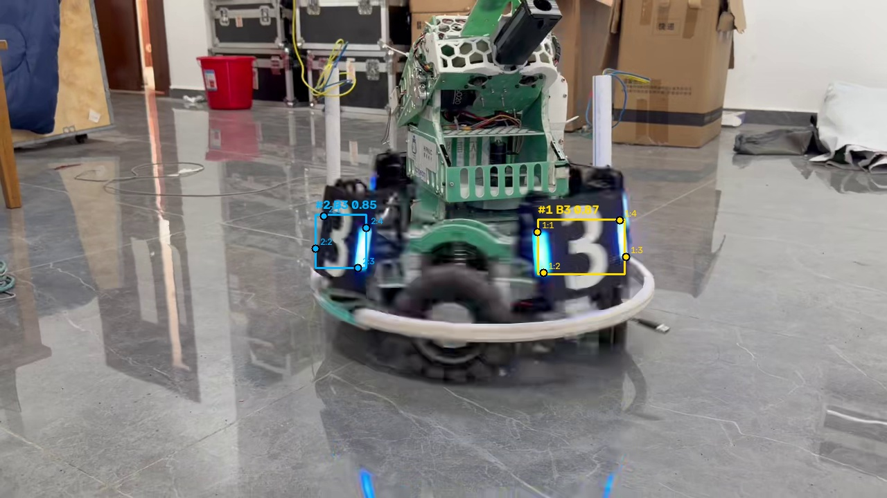

# YOLO PyTorch 与 ONNX 性能对比

## 实验条件

- CPU：Intel Core i7-10850H 2.70GHz；操作系统：Windows-10-10.0.19045-SP0；Python：3.12.10。
- 视频：`videos/armor_original.mp4`，410 帧，30 FPS，1280×720。
- 同一权重来源：已校验导出报告中的源模型/ONNX SHA-256；视频 SHA-256：`7e3468b44da8afc546aa476570db89ee3c3588ce6f284b893befb71d58a05830`。
- 统一 CPU、FP32、640×640、rect=False、conf=0.25、IoU=0.7、batch=1、max_det=300。
- 各预热 10 帧；随后按 PT→ONNX 顺序交替测量，各完整运行 3 轮。
- 计时范围：逐帧 `model.predict(...)` 调用，包含预处理、网络前向及后处理；排除模型加载、预热、视频解码、绘图、日志和文件保存。
- 使用各运行时的默认线程策略；ONNX 线程配置 0 表示运行时自动决定，不是零线程。线程和库版本详见原始 JSON。

## 测量结果

| 项目 | PyTorch `.pt` | ONNX |
|---|---|---|
| 模型大小 | 5,892,455 字节（5.62 MiB） | 10,196,332 字节（9.72 MiB） |
| 平均每帧预测耗时 | 58.257 ms | 42.044 ms |
| 预测吞吐量 | 17.17 FPS | 23.78 FPS |
| 轮均耗时的样本标准差 | 0.130 ms | 0.313 ms |
| 正式测量总帧数 | 1230 | 1230 |
| 每轮逐帧检测总次数 | [634, 634, 634] | [634, 634, 634] |

平均耗时 = 所有正式预测调用的总时间 / 总帧数；FPS = 总帧数 / 总时间。该 FPS 衡量预测调用吞吐量，视频播放仍为 30 FPS。

| 轮次 | PyTorch 平均 ms/帧 | ONNX 平均 ms/帧 | PyTorch FPS | ONNX FPS |
|---|---|---|---|---|
| 1 | 58.184 | 42.111 | 17.19 | 23.75 |
| 2 | 58.407 | 42.319 | 17.12 | 23.63 |
| 3 | 58.179 | 41.703 | 17.19 | 23.98 |

## 检测效果与解释

- 各轮逐帧检测数量全部一致。统计为跨帧累计检测次数，不是独立物体数。
- 第 3 步视频实验与本次来源/参数匹配；ONNX 视频已由用户确认可以播放。两份 H.264 文件指纹相同。
- 同一第 180 帧可见两个 B3 目标和各自四个预测关键点，抽查图如下。侧面漏检、运动模糊等问题仍应如实保留。




- 没有人工真值标注，未计算准确率、召回率或关键点误差；相同框数和可视化不表示所有浮点坐标完全相同。
- 本机本次实验：ONNX 平均每帧预测耗时降低 27.8%；耗时比 PyTorch/ONNX 为 1.386。结果适用于这里记录的模型、硬件及默认运行时配置。
- 速度差异可能受运行时算子优化、图优化、线程策略及系统负载影响；本实验未逐项消融这些因素。
- 原始 checkpoint 参数存储类型：['torch.float16']；两种模型本次都使用 FP32 进行 CPU 推理。ONNX 文件大小还受权重精度、图结构和文件组织影响，导出不保证文件更小。

## 复现与原始记录

```powershell
.\.venv\Scripts\python.exe -u benchmark.py --warmup 10 --repeats 3 --imgsz 640 --conf 0.25 --iou 0.7
```

已有结果时必须指定新的 `--output docs/benchmark_cpu_v2.json --report comparison_v2.md`，避免覆盖本次证据。
完整逐帧时间、每轮计数、模型指纹、实际执行顺序及环境见 [docs/benchmark_cpu.json](docs/benchmark_cpu.json)。
